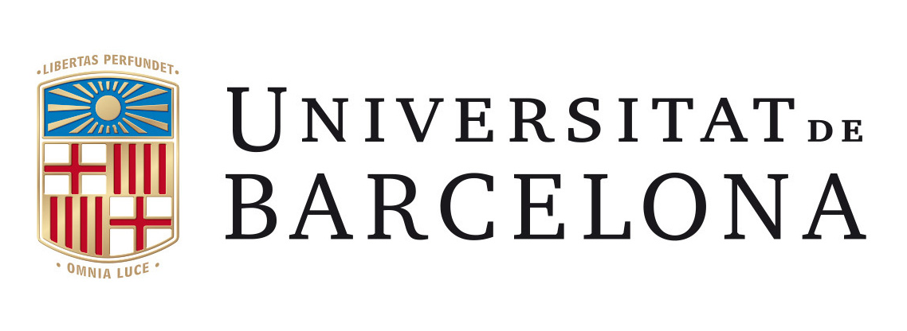

<a href="/" lang="en">English</a>

Soc professor agregat de Ciència Política a la Universitat de Barcelona, investigador ICREA Acadèmia i membre del grup de recerca C-BIC del Centre de Recerca en Institucions, Política i Economia (IPERC). Actualment soc el cap de la Secció Departamental de Ciència Política de la UB. Soc doctor en Ciència Política (Universitat Pompeu Fabra, 2009).

Entre el 2021 i el 2024 vaig ser director del Centre d'Estudis d'Opinió de la Generalitat de Catalunya.

Imparteixo docència en mètodes de recerca, comportament polític i política comparada. La meva recerca se centra en el comportament polític comparat i l'economia política històrica. He publicat recerca històrica sobre la incorporació política de les dones i dels treballadors arran de l'extensió del sufragi i la democratització, així com treballs experimentals sobre les conseqüències polítiques de la corrupció, el terrorisme, la violència política, la immigració o el secessionisme, entre d'altres.

He publicat a revistes com *World Politics*, *The Journal of Politics*, *Political Analysis*, el *British Journal of Political Science*, *Comparative Political Studies*, *Political Science Research and Methods*, el *Journal of Peace Research* o *Party Politics*, entre d'altres. Podeu trobar més informació als meus perfils de [Google Scholar](https://scholar.google.com/citations?user=T0Gv_wUAAAAJ&hl=ca) i [ORCID](https://orcid.org/0000-0002-2078-4047).

  

